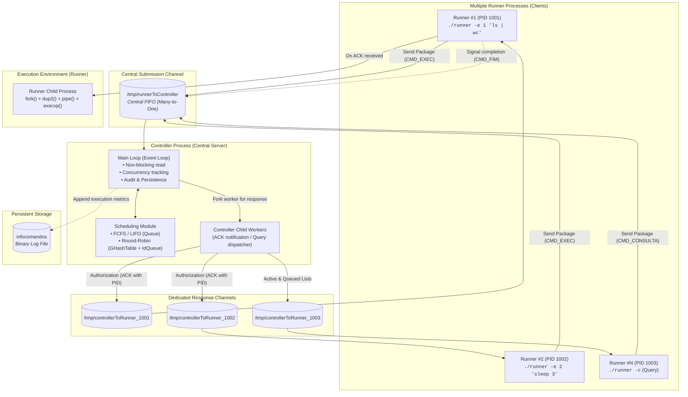
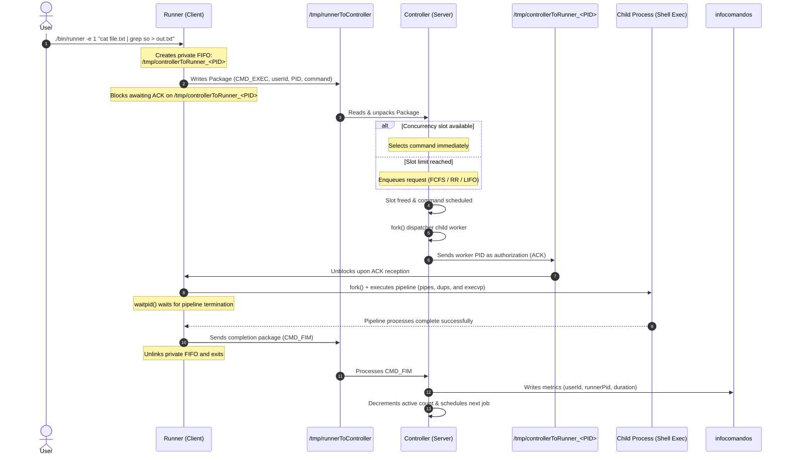

<div align="center">

# ⚙️ Concurrent Multi-Runner Execution Orchestrator

### *Client-Server C Environment for Task Scheduling, Concurrency Management, and Bash Pipeline Execution via IPC (Named Pipes / FIFOs)*

<p align="center">
  
  
  
  
  
  
</p>

<p align="center">
  <b>BSc in Computer Science (LEI)</b> • <b>Operating Systems (2nd Year / 2nd Semester)</b><br>
  Universidade do Minho — 2025/2026
</p>

---

[Overview](#-overview) •
[Key Features](#-key-features) •
[System Architecture](#-system-architecture) •
[Command Lifecycle](#-command-lifecycle) •
[Scheduling Policies](#-scheduling-policies) •
[Shell Engine & Pipelines](#-shell-engine--pipeline-support) •
[Project Structure](#-project-structure) •
[Installation & Build](#-installation--build) •
[Usage Guide](#-usage-guide) •
[Testing Suite](#-testing-suite) •
[Authors](#-authors)

---

</div>

## 📌 Overview

This project implements a **robust, distributed command orchestration and concurrent execution environment** developed in **C** on top of the POSIX/Linux system call API.

The system adopts an **asynchronous, decoupled client-server architecture**:
- **`controller` (Central Server):** Acts as the management core, admission controller, scheduler, and monitor. It enforces strict limits on concurrency (maximum simultaneous running jobs), queues pending tasks according to customizable scheduling policies, answers real-time inspection queries without stalling the main loop, and reliably persists job completion metrics into a binary log.
- **`runner` (Client CLI):** A lightweight client interface through which multiple users and automated scripts can independently submit jobs concurrently, inspect the global orchestrator state, or trigger a graceful shutdown. It embeds a custom C execution engine supporting multi-stage **pipelines (`|`)** and **I/O stream redirections (`<`, `>`, `2>`)**.

All inter-process communication (**IPC**) is performed exclusively via **Named Pipes (FIFOs)**, leveraging dynamically created per-client response channels keyed by their PID.

---

## ⚡ Key Features

- 👥 **Multi-Tenant & Multi-Client Support:** Concurrent submission from multiple distinct users identified by their `user-id`.
- 🚦 **Strict Concurrency Control:** Runtime-configurable limit on the maximum number of commands executing in parallel.
- ⏱️ **3 Pluggable Scheduling Policies:**
  - **FCFS (*First-Come, First-Served*):** Strict arrival-order queueing.
  - **Round-Robin per User:** Fair rotation across distinct users, eliminating resource monopolization (*starvation*).
  - **LIFO (*Last-In, First-Out*):** Priority given to the most recently submitted jobs.
- 🐚 **Advanced Shell Execution Engine:**
  - Command chaining via **Pipes (`|`)**.
  - Standard input redirection (**`<` stdin**).
  - Truncated standard output redirection (**`>` stdout**).
  - Standard error redirection (**`2>` stderr**).
  - Arbitrary combinations of pipelines and redirections within a single command.
- 🔍 **Real-Time Non-blocking Inspection (`-c`):** Instant snapshot of active and queued tasks, handled by an isolated worker process to ensure the scheduler remains responsive.
- 🛑 **Graceful Shutdown (`-s`):** Immediately stops accepting new tasks, drains all running and scheduled jobs, and safely unlinks all IPC resources before exiting.
- 💾 **Persistent Binary Accounting:** Atomic logging of completed commands into a binary record (`infocomandos`), capturing `user-id`, `command-id` (PID), and total turnaround time (in seconds).
- 🛡️ **Process Isolation & Cleanliness:** Active zombie prevention (`wait`/`waitpid`), race-condition-free IPC, and guaranteed cleanup of temporary FIFOs in `/tmp/`.

---

## 🏛️ System Architecture

The IPC topology relies on a shared multi-producer channel (*many-to-one*) and dedicated private response channels (*one-to-one*) for each client instance.



### IPC Protocol & Message Structure

Communication relies on structured binary payloads (`Package`) exchanged through FIFOs:

| Named Pipe | Direction | Purpose | Format / Payload |
|---|---|---|---|
| `/tmp/runnerToController` | Runner $\to$ Controller | Submissions, queries, task completion, and shutdown | Serialized `Package` struct containing `TipoComando`, `userId`, `runnerPid`, command string, and runner's return FIFO path |
| `/tmp/controllerToRunner_<PID>` | Controller $\to$ Runner | Execution authorization (ACK) or system state response | `pid_t` of the controller dispatcher worker or serialized active/scheduled lists |

---

## 🔄 Command Lifecycle



---

## 📊 Scheduling Policies

The system allows comparative evaluation of scheduling behavior under varying workloads:

```
                            ┌───────────────────────────────┐
                            │    Incoming Jobs (Requests)   │
                            └───────────────┬───────────────┘
                                            │
                     ┌──────────────────────┼──────────────────────┐
                     ▼                      ▼                      ▼
             ┌───────────────┐      ┌───────────────┐      ┌───────────────┐
             │   Option 1:   │      │   Option 2:   │      │   Option 3:   │
             │  FCFS / FIFO  │      │  Round-Robin  │      │  LIFO         │
             └───────┬───────┘      └───────┬───────┘      └───────┬───────┘
                     │                      │                      │
                     │                      │                      │
              Arrival Order          User Fairness          Inverted Stack
              Single Doubly-Linked   GHashTable + IdQueue   Latest submission
              Queue (Unbiased)       (Rotational turns)     executes first
```

| ID | Policy | Data Structures | Description & Behavior |
|:--:|:---|:---|:---|
| `1` | **FCFS**<br>*(First-Come, First-Served)* | Doubly-linked `Queue` | Natural chronological arrival order. The first submitted job is the first dispatched. Simple, deterministic, and baseline FIFO behavior. |
| `2` | **Round-Robin**<br>*(Per User)* | `GHashTable` (GLib) + user queue (`IdQueue`) + per-user `Queue` | Guarantees multi-user fairness. Each user has an independent queue; the scheduler cycles through `IdQueue`, dispatching one job per active user in each round. Prevents single-user starvation. |
| `3` | **LIFO**<br>*(Last-In, First-Out)* | Queue operated as a Stack (`Queue`) | The most recently submitted job is pushed to the head of the queue, prioritizing newer tasks over older pending ones. |

---

## 🛠️ Shell Engine & Pipeline Support

The `executer.c` component implements a lexical tokenizer and execution engine reproducing core POSIX shell behavior without invoking `/bin/sh` or `system()`, interacting directly with Linux kernel primitives:

```
Command: "cat access.log | grep 404 | wc -l > errors.txt 2> debug.log"
          ──────┬───────   ────┬────   ───┬── ──────┬─────── ─────┬─────
            Segment 0     Segment 1    Segment 2 │             │
                │              │              │     │             │
              stdout         stdout         stdout  │             │
                │              │              │     ▼             ▼
             pipe[0] ──────> pipe[1] ──────> fd   open()        open()
                                                  dup2(fd, 1)   dup2(fd, 2)
```

1. **Pipeline Segmentation (`|`):** The input command string is split into discrete executable segments. For segment $i$, a child process is spawned via `fork()` and wired via `pipe()` (connecting stdout of child $i$ to stdin of child $i+1$).
2. **Input Redirection (`<`):** Replaces `STDIN_FILENO (0)` with the file descriptor opened in read-only mode (`O_RDONLY`).
3. **Output Redirection (`>`):** Opens the target file (`O_WRONLY | O_CREAT | O_TRUNC, 0644`) and maps it to `STDOUT_FILENO (1)` using `dup2()`.
4. **Error Redirection (`2>`):** Opens the error log file and maps it to `STDERR_FILENO (2)` using `dup2()`.
5. **Image Replacement:** Each leaf process invokes `execvp()` with its sanitized argument vector.
6. **Pipeline Synchronization:** The parent runner process monitors and synchronizes all pipeline stages using `wait()` / `waitpid()` before notifying completion to the controller.

---

## 📂 Project Structure

```
projetoSO/
├── Relatório-SO-TP.pdf         # Complete academic report with design and benchmarks
├── README.md                   # Main project documentation
│
└── projeto/
    ├── Makefile                # Build configuration with optimization and dependency flags
    │
    ├── include/                # Header files (.h)
    │   ├── comandos.h          # Comando struct definitions and TipoComando enum
    │   ├── executer.h          # Command parser and execution pipeline signatures
    │   ├── hashRR.h            # GLib hash table interface for Round-Robin scheduling
    │   ├── package.h           # IPC Package structure and serialization helpers
    │   ├── queue.h             # Doubly-linked Queue interface and operations
    │   └── scheduler.h         # Scheduler policies, context, and selection logic
    │
    ├── src/                    # Source files (.c)
    │   ├── controller.c        # Central server: event loop, concurrency control, logging
    │   ├── runner.c            # CLI client: job submission, state polling, shutdown
    │   ├── executer.c          # Shell executor: pipelines, dup2, and redirections
    │   ├── scheduler.c         # Scheduling algorithms implementation (FCFS, RR, LIFO)
    │   ├── queue.c             # Queue and stack manipulation primitives
    │   ├── package.c           # Message serialization and binary logging
    │   ├── comandos.c          # CLI argument parsing and syntax validation
    │   └── hashRR.c            # User-to-queue hash mapping backed by GHashTable
    │
    ├── testes/                 # Automated test scripts and stress test benches
    │   ├── testes.sh           # 10 comprehensive end-to-end integration test scenarios
    │   ├── run_scheduler_tests.sh # Benchmarking script comparing scheduling policies
    │   └── limpar_testes.sh    # Cleanup script for temporary test files and FIFOs
    │
    ├── bin/                    # Compiled executable binaries (controller, runner, infocomandos)
    ├── obj/                    # Compiled object files (.o)
    └── tmp/                    # Directory for temporary runtime outputs
```

---

## 🚀 Installation & Build

### System Dependencies

The project requires a C compiler supporting **POSIX.1-2008**, **GNU Make**, and **GLib 2.0** (used for the Round-Robin hash table).

#### Debian / Ubuntu / Mint:
```bash
sudo apt update
sudo apt install build-essential libglib2.0-dev
```

#### Arch Linux / Manjaro:
```bash
sudo pacman -S base-devel glib2
```

#### Fedora / RHEL:
```bash
sudo dnf install gcc make glib2-devel
```

---

### Compilation

To compile all modules and generate the binaries:

```bash
cd projeto
make
```

The resulting executables will be placed in `bin/`:
- `bin/controller` — Central scheduling server.
- `bin/runner` — Task submission and execution client.
- `bin/infocomandos` — Binary log reader utility.

To clean intermediate object files and binaries:
```bash
make clean
```

---

## 💻 Usage Guide

### 1. Starting the `controller`

In a dedicated terminal, launch the orchestrator specifying the maximum concurrent execution capacity and the scheduling policy:

```bash
./bin/controller <parallel-commands> <sched-policy>
```

| Argument | Type | Description |
|---|:---:|---|
| `<parallel-commands>` | `Integer > 0` | Maximum number of commands allowed to execute simultaneously. |
| `<sched-policy>` | `1 \| 2 \| 3` | `1` = **FCFS** (First-Come, First-Served)<br>`2` = **Round-Robin** (per User)<br>`3` = **LIFO** (Last-In, First-Out) |

**Examples:**
```bash
# Allow up to 2 parallel commands using FCFS scheduling
./bin/controller 2 1

# Allow up to 4 parallel commands using Round-Robin per user
./bin/controller 4 2
```

---

### 2. Submitting Commands with `runner` (`-e`)

In another terminal window, submit commands associated with a user ID:

```bash
./bin/runner -e <user-id> "<command> [args...]"
```

#### Simple Commands:
```bash
./bin/runner -e 1 "echo 'Hello, Operating Systems!'"
./bin/runner -e 2 "sleep 5"
```

#### Pipelines & Redirections:
```bash
# Standard pipeline
./bin/runner -e 1 "grep root /etc/passwd | wc -l"

# Output redirection (stdout > out.txt)
./bin/runner -e 2 "ls -la /usr/bin > bin_list.txt"

# Input redirection (stdin < input.txt)
./bin/runner -e 1 "wc -w < bin_list.txt"

# Error redirection (stderr 2> error.log)
./bin/runner -e 3 "ls non_existent_file 2> error.log"

# Combined pipeline with stdout and stderr redirections
./bin/runner -e 1 "cat /etc/passwd | sort | uniq > output.txt 2> err.log"
```

**Terminal Output Example:**
```console
$ ./bin/runner -e 1 "echo Hello World"
[runner] command 48291 submitted
[runner] executing command 48291...
Hello World
[runner] command 48291 finished
```

---

### 3. Inspecting Running & Queued Commands (`-c`)

To inspect real-time orchestrator load and queue state:

```bash
./bin/runner -c
```

**Sample Output:**
```console
$ ./bin/runner -c
---
Executing
user-id 1 - command-id 48291
user-id 2 - command-id 48295
---
Scheduled
user-id 1 - command-id 48301
user-id 3 - command-id 48304
```

---

### 4. Graceful Controller Shutdown (`-s`)

To initiate a controlled shutdown:

```bash
./bin/runner -s
```

> [!IMPORTANT]
> The `controller` immediately stops accepting new commands, waits for all active and scheduled jobs in the queue to complete their execution, and only then unlinks its FIFOs and exits safely.

---

### 5. Inspecting the Persistent Log (`infocomandos`)

Each finished command writes its execution metrics into a binary log. To read the historical records:

```bash
./bin/infocomandos
```

Displays each job's **User ID**, **Command ID (PID)**, and **Total duration** (in seconds).

---

## 🧪 Testing Suite

The repository includes automated shell scripts for regression testing and concurrent stress evaluation.

### Running End-to-End Functional Tests

```bash
cd projeto/testes
bash testes.sh
```

The automated suite validates 10 key scenarios:
1. `Test 1`: Basic single-command lifecycle.
2. `Test 2`: State inspection with queued commands (`-c`).
3. `Test 3`: Pipeline chaining (`|`).
4. `Test 4`: Standard output redirection (`>`).
5. `Test 5`: Standard input redirection (`<`).
6. `Test 6`: Standard error redirection (`2>`).
7. `Test 7`: Combined Pipeline + Output redirection.
8. `Test 8`: Execution timing under varying parallelism (1, 2, and 3 concurrent workers).
9. `Test 9`: Cross-validation and order verification across all 3 scheduling policies.
10. `Test 10`: High-concurrency stress test with 10 simultaneous runners.

### Scheduling Policy Benchmark

```bash
bash run_scheduler_tests.sh
```

### Cleaning Test Artifacts

```bash
bash limpar_testes.sh
```

---

## 👥 Authors

Developed as part of the **Operating Systems** course in the 2nd year of the BSc in Computer Science at **Universidade do Minho**:

| Avatar | Name | Student ID | GitHub |
|:---:|:---|:---:|:---:|
|  | **Afonso Manuel Almeida da Costa** | `a110544` | [@afonso35costa](https://github.com/afonso35costa) |
|  | **António Pedro Martins da Silva** | `a111962` | — |
|  | **Cristiano Afonso Lima Gomes** | `a111836` | — |

---

<div align="center">
  <sub>BSc in Computer Science (LEI) • Department of Informatics • Universidade do Minho • 2025/2026</sub>
</div>
