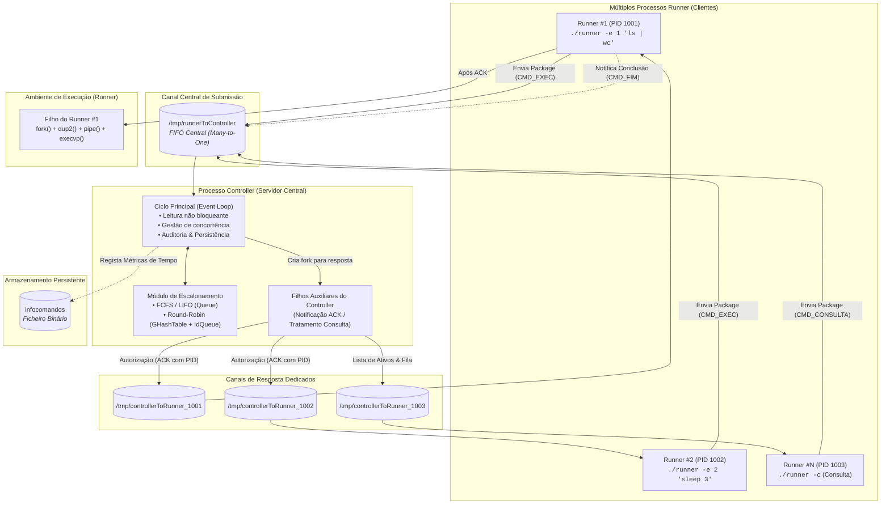
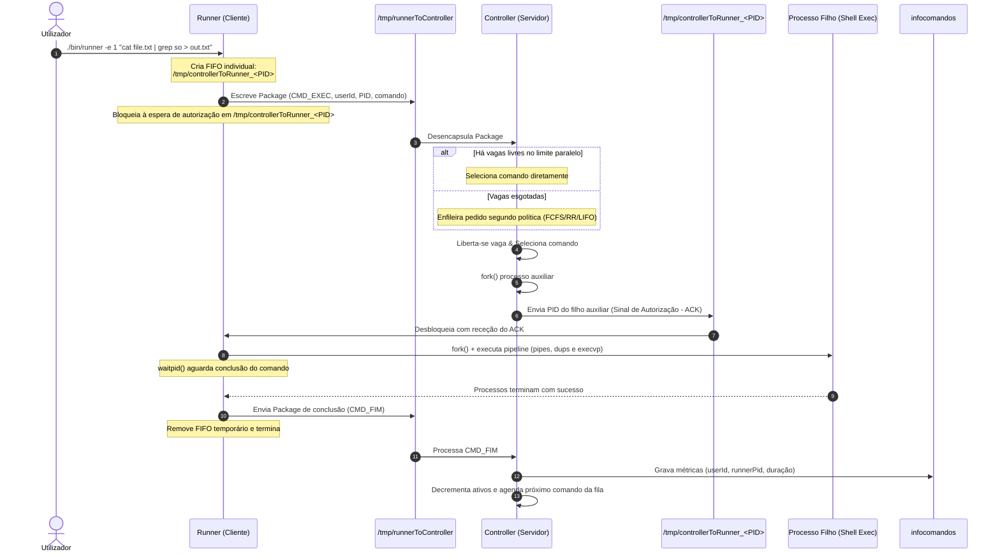

<div align="center">

# ⚙️ Orquestrador de Execução Concorrente & Multi-Runner

### *Ambiente Cliente-Servidor em C para Escalonamento, Gestão de Concorrência e Execução de Pipelines Bash via IPC (Named Pipes / FIFOs)*

<p align="center">
  
  
  
  
  
  
</p>

<p align="center">
  <b>Licenciatura em Engenharia Informática</b> • <b>Sistemas Operativos (2º Ano / 2º Semestre)</b><br>
  Universidade do Minho — 2025/2026
</p>

---

[Visão Geral](#-visão-geral) •
[Funcionalidades](#-funcionalidades-chave) •
[Arquitetura](#-arquitetura-do-sistema) •
[Ciclo de Vida](#-ciclo-de-vida-de-um-comando) •
[Políticas de Escalonamento](#-políticas-de-escalonamento) •
[Motor Shell & Operadores](#-suporte-a-operadores-shell--pipelines) •
[Estrutura](#-estrutura-do-projeto) •
[Instalação & Compilação](#-instalação-e-compilação) •
[Manual de Utilização](#-manual-de-utilização) •
[Testes](#-bateria-de-testes) •
[Autores](#-autores)

---

</div>

## 📌 Visão Geral

Este projeto consiste num **ambiente robusto e distribuído de orquestração e execução concorrente de comandos shell**, desenhado em **C** sobre a API de chamadas de sistema POSIX/Linux.

O sistema adota uma **arquitetura cliente-servidor assíncrona** desacoplada:
- **`controller` (Servidor Central):** Atua como o núcleo de gestão, controlo de admissão, escalonamento e monitorização. Mantém o controlo rigoroso do grau de paralelismo (máximo de comandos simultâneos em execução), enfileira tarefas pendentes de acordo com diferentes políticas de escalonamento, atende consultas em tempo real sem bloqueio do fluxo principal e faz a persistência binária do histórico de execuções.
- **`runner` (Cliente):** Interface de linha de comandos através da qual múltiplos utilizadores e scripts podem submeter comandos de forma independente e simultânea, consultar o estado global do orquestrador ou solicitar o encerramento gracioso (*graceful shutdown*). Dispõe de um motor em C para interpretação e execução de comandos encadeados com **pipelines (`|`)** e **redirecionamentos de I/O (`<`, `>`, `2>`)**.

Toda a comunicação inter-processos (**IPC**) é realizada exclusivamente com recurso a **Named Pipes (FIFOs)**, com criação dinâmica de canais dedicados por cliente identificados pelo respetivo PID.

---

## ⚡ Funcionalidades-Chave

- 👥 **Modelo Multi-Tenant & Multi-Cliente:** Suporte à submissão simultânea de pedidos por múltiplos utilizadores identificados (`user-id`).
- 🚦 **Controlo Estrito de Concorrência:** Limite configurável em tempo de arranque para o número máximo de comandos a executar em paralelo.
- ⏱️ **3 Políticas de Escalonamento Configuráveis:**
  - **FCFS (*First-Come, First-Served*):** Ordem cronológica estrita de submissão.
  - **Round-Robin por Utilizador:** Alternância justa de turnos de execução entre utilizadores distintos, prevenindo a monopolização de recursos (*starvation*).
  - **LIFO (*Last-In, First-Out*):** Execução prioritária das tarefas mais recentes.
- 🐚 **Motor de Execução Shell Avançado:**
  - Encadeamento de múltiplos comandos via **Pipes (`|`)**.
  - Redirecionamento de entrada padrão (**`<` stdin**).
  - Redirecionamento de saída padrão truncada (**`>` stdout**).
  - Redirecionamento de fluxo de erros (**`2>` stderr**).
  - Composição arbitrária de pipes e redirecionamentos no mesmo comando.
- 🔍 **Consulta de Estado em Tempo Real (`-c`):** Obtenção imediata do número e identificação de comandos ativos e em fila de espera, tratada concorrentemente via processo filho sem bloquear o escalonador.
- 🛑 **Encerramento Gracioso (*Graceful Shutdown* - `-s`):** Suspensão imediata de novas admissões, drenagem completa de comandos agendados e em execução, e finalização segura sem processos órfãos ou dados corrompidos.
- 💾 **Auditoria & Registo Persistente:** Gravação atómica num ficheiro binário (`infocomandos`) de metadados essenciais de cada comando concluído (`user-id`, `command-id` / PID e duração total em segundos).
- 🛡️ **Isolamento e Robustez:** Prevenção ativa de processos *zombie* (recolha com `wait`/`waitpid`), proteção contra *race conditions* e limpeza garantida dos FIFOs em `/tmp/`.

---

## 🏛️ Arquitetura do Sistema

A topologia do sistema baseia-se num canal de receção central partilhado (*many-to-one*) e canais de resposta dedicados por processo cliente (*one-to-one*).



### Protocolo de Mensagens e Mecanismos IPC

A comunicação assenta em estruturas de dados serializadas (`Package`), transmitidas via FIFOs:

| Named Pipe | Direção | Propósito | Formato / Mensagem |
|---|---|---|---|
| `/tmp/runnerToController` | Runner $\to$ Controller | Submissão de comandos, consultas, término e encerramento | Estrutura binária `Package` contendo `TipoComando`, `userId`, `runnerPid`, argumentos e nome do FIFO de retorno |
| `/tmp/controllerToRunner_<PID>` | Controller $\to$ Runner | Autorização de arranque (ACK) ou envio de estado do sistema | `pid_t` do processo validador ou blocos com listas de comandos em espera/execução |

---

## 🔄 Ciclo de Vida de um Comando



---

## 📊 Políticas de Escalonamento

O sistema permite avaliar o comportamento do escalonador perante diferentes tipos de carga:

```
                            ┌───────────────────────────────┐
                            │   Chegada de Pedidos (Jobs)   │
                            └───────────────┬───────────────┘
                                            │
                     ┌──────────────────────┼──────────────────────┐
                     ▼                      ▼                      ▼
             ┌───────────────┐      ┌───────────────┐      ┌───────────────┐
             │  Opção 1:     │      │  Opção 2:     │      │  Opção 3:     │
             │  FCFS / FIFO  │      │  Round-Robin  │      │  LIFO         │
             └───────┬───────┘      └───────┬───────┘      └───────┬───────┘
                     │                      │                      │
                     │                      │                      │
              Ordem de Chegada       Equidade por User      Pilha Invertida
              Fila Única Convenc.    Hash (GLib) + IdQueue  Último a chegar é
              (Sem prioridades)      (Turnos alternados)    o primeiro a sair
```

| ID | Política | Estruturas de Dados | Descrição & Propósito |
|:--:|:---|:---|:---|
| `1` | **FCFS**<br>*(First-Come, First-Served)* | Fila duplamente ligada (`Queue`) | Ordem natural de chegada. O primeiro pedido submetido é o primeiro a ser despachado. Simples e determinístico. |
| `2` | **Round-Robin**<br>*(Por Utilizador)* | `GHashTable` (GLib) + `Queue` de utilizadores (`IdQueue`) + `Queue` por utilizador | Garante equidade (*fairness*). Cada utilizador possui a sua própria fila; o escalonador percorre ciclicamente a `IdQueue`, executando um comando de cada utilizador por turno. Evita que um utilizador monopolize as vagas. |
| `3` | **LIFO**<br>*(Last-In, First-Out)* | Fila operada como Pilha (`Queue`) | O comando mais recentemente submetido passa à frente da fila de espera, simulando priorização das tarefas mais recentes. |

---

## 🛠️ Suporte a Operadores Shell & Pipelines

O módulo `executer.c` implementa um parser léxico e um motor de execução capaz de reproduzir comportamentos de uma shell POSIX sem invocar `/bin/sh` ou `system()`, manipulando diretamente primitivas de baixo nível:

```
Comando: "cat access.log | grep 404 | wc -l > errors.txt 2> debug.log"
          ──────┬───────   ────┬────   ───┬── ──────┬─────── ─────┬─────
            Segmento 0     Segmento 1    Segmento 2 │             │
                │              │              │     │             │
              stdout         stdout         stdout  │             │
                │              │              │     ▼             ▼
             pipe[0] ──────> pipe[1] ──────> fd   open()        open()
                                                  dup2(fd, 1)   dup2(fd, 2)
```

1. **Segmentação da Pipeline (`|`):** O comando é decomposto em múltiplos segmentos independentes. Para cada segmento $i$, é criado um processo filho via `fork()` interligado através de `pipe()` (`stdout` do processo $i$ redirecionado para o `stdin` do processo $i+1$).
2. **Redirecionamento de Entrada (`<`):** Substituição do descritor de leitura `STDIN_FILENO (0)` pelo descritor do ficheiro aberto em modo só de leitura (`O_RDONLY`).
3. **Redirecionamento de Saída (`>`):** Abertura do ficheiro destino (`O_WRONLY | O_CREAT | O_TRUNC, 0644`) e substituição de `STDOUT_FILENO (1)` via `dup2()`.
4. **Redirecionamento de Erros (`2>`):** Abertura do ficheiro destino e substituição de `STDERR_FILENO (2)` via `dup2()`.
5. **Substituição de Imagem:** Cada nó folha da pipeline executa `execvp()` com a lista isolada de argumentos.
6. **Sincronização:** O processo pai monitoriza e aguarda a terminação de todos os processos da cadeia recorrendo a `wait()` antes de reportar a conclusão ao controller.

---

## 📂 Estrutura do Projeto

```
projetoSO/
├── Relatório-SO-TP.pdf         # Relatório técnico completo de conceção e avaliação
├── README.md                   # Documentação principal do projeto
│
└── projeto/
    ├── Makefile                # Regras de compilação automatizada com flags de otimização
    │
    ├── include/                # Ficheiros de cabeçalho (.h)
    │   ├── comandos.h          # Definição das estruturas Comando e enum TipoComando
    │   ├── executer.h          # Assinaturas do interpretador e despachante de comandos/pipes
    │   ├── hashRR.h            # Interface da tabela de hash (GLib) para política Round-Robin
    │   ├── package.h           # Estrutura Package para encapsulamento das mensagens IPC
    │   ├── queue.h             # Interface da estrutura de dados Fila duplamente ligada
    │   └── scheduler.h         # Definição das políticas de escalonamento e contexto
    │
    ├── src/                    # Código-fonte da solução (.c)
    │   ├── controller.c        # Servidor central: event-loop, admissão e persistência
    │   ├── runner.c            # Cliente CLI: emissão de pedidos e orquestração de execução
    │   ├── executer.c          # Motor de execução com suporte a pipes, dup2 e redirecionamentos
    │   ├── scheduler.c         # Implementação das políticas de escalonamento (FCFS, RR, LIFO)
    │   ├── queue.c             # Primitivas de manipulação de filas FIFO/LIFO
    │   ├── package.c           # Serialização, deserialização e logging em disco
    │   ├── comandos.c          # Parser e validação sintática da linha de comandos
    │   └── hashRR.c            # Mapeamento utilizador-fila recorrendo a GHashTable
    │
    ├── testes/                 # Scripts Bash de validação e testes de stress
    │   ├── testes.sh           # Bateria de 10 testes funcionais integrados
    │   ├── run_scheduler_tests.sh # Benchmarking e comparação das políticas de escalonamento
    │   └── limpar_testes.sh    # Script de limpeza de ficheiros temporários de teste
    │
    ├── bin/                    # Binários executáveis gerados (controller, runner, infocomandos)
    ├── obj/                    # Ficheiros objeto intermediários (.o)
    └── tmp/                    # Diretório para armazenamento temporário de testes
```

---

## 🚀 Instalação e Compilação

### Dependências do Sistema

O projeto requer um compilador C com suporte a **POSIX.1-2008**, **GNU Make** e a biblioteca **GLib 2.0** (utilizada na tabela de hash do escalonador Round-Robin).

#### Debian / Ubuntu / Mint:
```bash
sudo apt update
sudo apt install build-essential libglib2.0-dev
```

#### Arch Linux / Manjaro:
```bash
sudo pacman -S base-devel glib2
```

#### Fedora / RHEL:
```bash
sudo dnf install gcc make glib2-devel
```

---

### Compilação

Para compilar todos os módulos e gerar os binários executáveis:

```bash
cd projeto
make
```

Os ficheiros executáveis serão gerados na pasta `bin/`:
- `bin/controller` — Servidor central de escalonamento.
- `bin/runner` — Cliente de submissão e execução de tarefas.
- `bin/infocomandos` — Utilitário de leitura do ficheiro de registo binário.

Para limpar os artefactos de compilação:
```bash
make clean
```

---

## 💻 Manual de Utilização

### 1. Inicializar o `controller`

Num terminal dedicado, inicie o processo coordenador definindo a capacidade concorrente e a política de escalonamento desejada:

```bash
./bin/controller <max-comandos-paralelos> <politica-escalonamento>
```

| Argumento | Tipo | Descrição |
|---|:---:|---|
| `<max-comandos-paralelos>` | `Inteiro > 0` | Número máximo de comandos autorizados a executar em simultâneo. |
| `<politica-escalonamento>` | `1 \| 2 \| 3` | `1` = **FCFS** (First-Come, First-Served)<br>`2` = **Round-Robin** (por Utilizador)<br>`3` = **LIFO** (Last-In, First-Out) |

**Exemplos:**
```bash
# Permitir 2 comandos em simultâneo com política FCFS
./bin/controller 2 1

# Permitir 4 comandos em simultâneo com Round-Robin por utilizador
./bin/controller 4 2
```

---

### 2. Submeter Comandos com o `runner` (`-e`)

Noutra janela de terminal, execute comandos associando um identificador de utilizador:

```bash
./bin/runner -e <user-id> "<comando> [argumentos...]"
```

#### Exemplos de Comandos Simples:
```bash
./bin/runner -e 1 "echo 'Olá, Sistemas Operativos!'"
./bin/runner -e 2 "sleep 5"
```

#### Exemplos com Redirecionamentos e Pipelines:
```bash
# Pipeline simples
./bin/runner -e 1 "grep root /etc/passwd | wc -l"

# Redirecionamento de saída (stdout > out.txt)
./bin/runner -e 2 "ls -la /usr/bin > lista_bin.txt"

# Redirecionamento de entrada (stdin < input.txt)
./bin/runner -e 1 "wc -w < lista_bin.txt"

# Redirecionamento de erro (stderr 2> erro.log)
./bin/runner -e 3 "ls ficheiro_que_nao_existe 2> erro.log"

# Composição combinada de pipeline com redirecionamento de erro e saída
./bin/runner -e 1 "cat /etc/passwd | sort | uniq > output.txt 2> err.log"
```

**Exemplo de Output no Terminal:**
```console
$ ./bin/runner -e 1 "echo Hello World"
[runner] command 48291 submitted
[runner] executing command 48291...
Hello World
[runner] command 48291 finished
```

---

### 3. Consultar Comandos Ativos e em Espera (`-c`)

Para verificar em tempo real o estado de ocupação do escalonador:

```bash
./bin/runner -c
```

**Exemplo de Resposta:**
```console
$ ./bin/runner -c
---
Executing
user-id 1 - command-id 48291
user-id 2 - command-id 48295
---
Scheduled
user-id 1 - command-id 48301
user-id 3 - command-id 48304
```

---

### 4. Encerramento Gracioso do Sistema (`-s`)

Para solicitar a finalização planeada do sistema:

```bash
./bin/runner -s
```

> [!IMPORTANT]
> O `controller` suspende imediatamente a receção de novos pedidos, aguarda que todos os comandos que se encontrem em execução ou agendados na fila de espera concluam o seu processamento normal e apenas nessa altura liberta os recursos e FIFOs antes de terminar.

---

### 5. Inspecionar o Registo Persistente (`infocomandos`)

Cada comando concluído tem os seus dados gravados num registo binário estruturado. Para consultar o histórico detalhado:

```bash
./bin/infocomandos
```

Exibe a lista com o **User ID**, **Command ID (PID)** e a **Duração total de execução** (em segundos).

---

## 🧪 Bateria de Testes

O repositório inclui um conjunto de ferramentas de teste automatizadas para validação funcional e verificação de robustez sob concorrência.

### Executar a Suite de Testes Funcionais

```bash
cd projeto/testes
bash testes.sh
```

A suite cobre 10 cenários abrangentes:
1. `Teste 1`: Execução básica e ciclo normal de vida.
2. `Teste 2`: Consulta com comandos em fila de espera (`-c`).
3. `Teste 3`: Validação de pipelines (`|`).
4. `Teste 4`: Redirecionamento de saída padrão (`>`).
5. `Teste 5`: Redirecionamento de entrada padrão (`<`).
6. `Teste 6`: Redirecionamento de descritor de erro (`2>`).
7. `Teste 7`: Composição simultânea de Pipe + Redirecionamento de saída.
8. `Teste 8`: Comparação de tempos perante variação do grau de paralelismo (1, 2 e 3 workers simultâneos).
9. `Teste 9`: Validação cruzada e análise de ordenação das 3 políticas de escalonamento.
10. `Teste 10`: Teste de carga e stress com 10 runners concorrentes em simultâneo.

### Teste Específico às Políticas de Escalonamento

```bash
bash run_scheduler_tests.sh
```

### Limpeza de Artefactos de Teste

```bash
bash limpar_testes.sh
```

---

## 👥 Autores

Trabalho desenvolvido no âmbito da unidade curricular de **Sistemas Operativos** do 2º ano da Licenciatura em Engenharia Informática da **Universidade do Minho**:

| Foto | Nome | Número de Estudante | GitHub |
|:---:|:---|:---:|:---:|
|  | **Afonso Manuel Almeida da Costa** | `a110544` | [@afonso35costa](https://github.com/afonso35costa) |
|  | **António Pedro Martins da Silva** | `a111962` | — |
|  | **Cristiano Afonso Lima Gomes** | `a111836` | — |

---

<div align="center">
  <sub>Licenciatura em Engenharia Informática • Departamento de Informática • Universidade do Minho • 2025/2026</sub>
</div>
